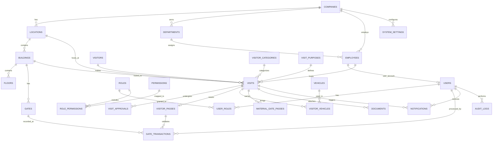

# VISITFLOW — Database Entity Relationship Diagram (ERD)

### Table Inventory & Key Fields

1. **COMPANIES**: `id`, `code`, `name`, `tax_id`, `contact_email`, `phone`, `logo_url`, `is_active`, `created_at`
2. **LOCATIONS**: `id`, `company_id`, `code`, `name`, `address_line1`, `city`, `state`, `country`, `timezone`, `is_active`
3. **BUILDINGS**: `id`, `location_id`, `code`, `name`, `emergency_evac_point`, `is_active`
4. **FLOORS**: `id`, `building_id`, `floor_number`, `name`, `access_level_required`
5. **GATES**: `id`, `building_id`, `code`, `name`, `gate_type` (ENTRY / EXIT / BI_DIRECTIONAL), `is_vehicle_accessible`
6. **DEPARTMENTS**: `id`, `company_id`, `code`, `name`, `head_employee_id`, `is_active`
7. **EMPLOYEES**: `id`, `company_id`, `department_id`, `employee_code`, `full_name`, `email`, `phone`, `designation`
8. **USERS**: `id`, `company_id`, `employee_id`, `username`, `email`, `hashed_password`, `is_active`, `failed_attempts`
9. **ROLES**: `id`, `code`, `name`, `description`, `is_system_role`
10. **PERMISSIONS**: `id`, `module`, `action`, `code`, `description`
11. **USER_ROLES**: `user_id`, `role_id`, `assigned_at`
12. **ROLE_PERMISSIONS**: `role_id`, `permission_id`
13. **VISITORS**: `id`, `visitor_code`, `first_name`, `last_name`, `email`, `mobile_number`, `company_name`, `id_doc_type`, `masked_id_number`, `photo_url`, `is_blacklisted`
14. **VISITOR_CATEGORIES**: `id`, `code`, `name`, `requires_nda`, `requires_safety_briefing`, `requires_host_escort`
15. **VISIT_PURPOSES**: `id`, `code`, `name`, `default_duration_hours`, `is_active`
16. **APPOINTMENTS / VISITS**: `id`, `visit_number`, `visitor_id`, `company_id`, `location_id`, `building_id`, `gate_id`, `host_employee_id`, `category_id`, `purpose_id`, `scheduled_arrival`, `scheduled_departure`, `actual_arrival`, `actual_departure`, `status` (`DRAFT`, `PENDING_APPROVAL`, `APPROVED`, `REJECTED`, `CHECKED_IN`, `CHECKED_OUT`, `CANCELLED`, `EXPIRED`, `NO_SHOW`), `accompanying_count`, `nda_accepted`, `safety_accepted`, `remarks`
17. **VISIT_APPROVALS**: `id`, `visit_id`, `approver_user_id`, `approval_level`, `status`, `comments`, `decided_at`
18. **VISITOR_PASSES**: `id`, `visit_id`, `pass_number`, `qr_token`, `qr_payload`, `valid_from`, `valid_until`, `is_revoked`, `max_entries`, `current_entries`
19. **GATE_TRANSACTIONS**: `id`, `pass_id`, `visit_id`, `gate_id`, `security_user_id`, `transaction_type` (`CHECK_IN`, `CHECK_OUT`, `DENIED`), `idempotency_key`, `timestamp`, `device_info`, `notes`
20. **VEHICLES**: `id`, `vehicle_type`, `registration_number`, `make_model`, `color`
21. **VISITOR_VEHICLES**: `id`, `visit_id`, `vehicle_id`, `parking_slot`, `gate_in_id`, `gate_out_id`
22. **MATERIAL_GATE_PASSES**: `id`, `visit_id`, `pass_type` (`RETURNABLE`, `NON_RETURNABLE`), `item_description`, `serial_number`, `quantity`, `is_verified_in`, `is_verified_out`
23. **DOCUMENTS**: `id`, `visit_id`, `visitor_id`, `doc_type`, `file_name`, `storage_path`, `uploaded_at`
24. **NOTIFICATION_TEMPLATES**: `id`, `event_type`, `channel` (`IN_APP`, `EMAIL`, `SMS`, `WHATSAPP`), `subject`, `template_body`
25. **NOTIFICATIONS**: `id`, `user_id`, `visit_id`, `channel`, `title`, `message`, `is_read`, `created_at`
26. **WORKFLOW_RULES**: `id`, `category_id`, `department_id`, `required_approval_levels`, `escalation_timeout_minutes`
27. **AUDIT_LOGS**: `id`, `actor_user_id`, `action`, `entity_name`, `entity_id`, `before_state`, `after_state`, `ip_address`, `timestamp`
28. **SYSTEM_SETTINGS**: `id`, `company_id`, `key_name`, `setting_value`, `category`, `description`
